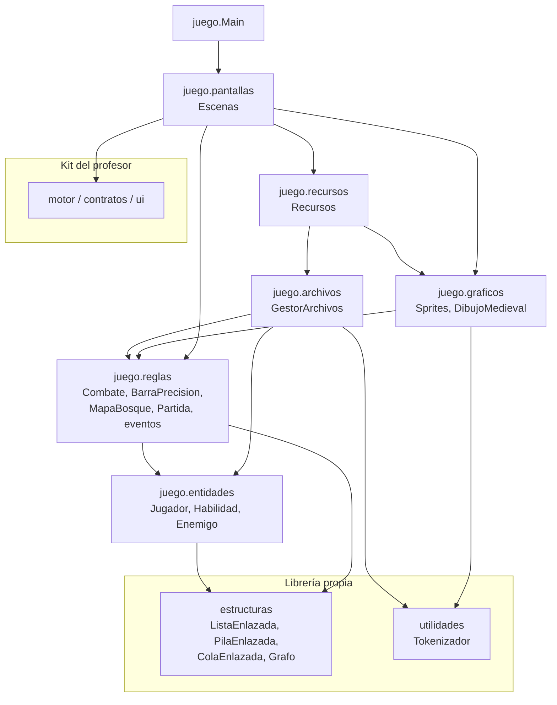
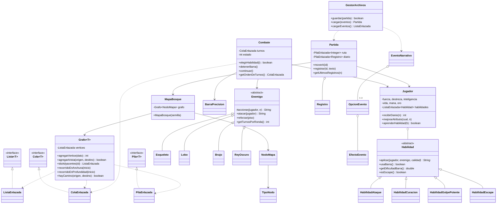

# Diseño y diagrama de clases

## 1. Idea general

El juego tiene **tres capas** que no se mezclan:

1. **Estructuras** (`estructuras`, `utilidades`): la librería propia. No sabe nada del juego.
2. **Lógica** (`juego.entidades`, `juego.reglas`, `juego.archivos`): las reglas. No dibuja nada ni usa Swing, por eso se puede probar sin ventana (`PruebaJuego`).
3. **Presentación** (`juego.graficos`, `juego.pantallas`, `juego.recursos`): lee el teclado, le pide cosas a la lógica y dibuja lo que ella dice.



Las flechas van siempre "hacia abajo": **no hay dependencias circulares** entre paquetes (se revisó con `grep` de los `import`).
Por eso `Habilidad` no usa la barra: el resultado de la barra viaja como un número (`Calidad.FALLO/NORMAL/CRITICO`) definido en `entidades`.

## 2. Qué estructura se usa para qué (requisito de la cátedra)

| Estructura | Clase | Dónde se usa | Por qué esa y no otra |
|---|---|---|---|
| **Grafo dirigido** (listas de adyacencia) | `Grafo<T>` | `MapaBosque`: cada lugar es un vértice y cada camino una arista | Los caminos tienen forma de red y solo se avanza en un sentido |
| **Lista enlazada** | `ListaEnlazada<T>` | Repertorio de habilidades del `Jugador` (máx. 4), opciones de cada `EventoNarrativo`, efectos de cada opción, lista de adyacencia de cada vértice, eventos cargados | Pocos elementos, se recorren siempre de principio a fin, se agregan al final |
| **Cola enlazada** (FIFO) | `ColaEnlazada<T>` | `Combate`: los turnos (Jugador / Enemigo); `Grafo`: recorrido en anchura | El primero en llegar es el primero en actuar |
| **Pila enlazada** (LIFO) | `PilaEnlazada<T>` | `Partida`: la ruta de nodos visitados y el diario de decisiones; `Grafo`: recorrido en profundidad | Lo más reciente es lo que importa (último lugar, últimas decisiones) |

## 3. Diagrama de clases (lógica)



## 4. Cómo se conectan las piezas (paso a paso)

### 4.1 Las estadísticas y el combate

Todo parte de tres números del `Jugador`: **Fuerza, Destreza e Inteligencia**. Las demás cifras son fórmulas simples de esos tres:

| Fórmula (en `Jugador`) | Con 3/3/3 | Quién la usa |
|---|---|---|
| Vida máxima = 20 + 5 × Fuerza | 35 | Hud, `curar`, `mejorarAtributo` |
| Daño físico = 2 + 2 × Fuerza | 8 | `HabilidadAtaque` |
| Defensa = Destreza ÷ 2 (entero) | 1 | `recibirDanio` (el daño baja en 1, mínimo 1) |
| Zona crítica extra = 4 × Destreza (píxeles) | 12 | `BarraPrecision` (zona crítica más ancha) |
| Factor de velocidad = 1 − 0,03 × Destreza (mín. 0,5) | 0,91 | `BarraPrecision` (cursor más lento) |
| Maná máximo = 6 + 3 × Inteligencia | 15 | Hud, `cambiarMana` |
| Potencia mágica = 3 + 3 × Inteligencia | 12 | `HabilidadGolpePotente` |
| Curación = 6 + 3 × Inteligencia | 15 | `HabilidadCuracion` |

El recorrido de **un turno del jugador** es:

1. `EscenaCombate` lee una tecla y llama `combate.elegirHabilidad(i)`.
2. `Combate` mira que haya maná y que no sea un escape contra el jefe. Gasta el maná.
3. Si la habilidad `usaBarra()`, crea una `BarraPrecision(jugador, habilidad.getDificultadBarra())`. Ahí entra la **Destreza**: el constructor pide al jugador su bonus de zona crítica y su factor de velocidad.
4. La escena llama `combate.actualizar(dt)` en cada cuadro (el cursor se mueve) y, cuando se aprieta ESPACIO, `combate.detenerBarra()`.
5. La barra devuelve una `Calidad` (fallo, normal o crítico) y `Combate` llama `habilidad.aplicar(jugador, enemigo, calidad)`. Ahí entran **Fuerza** e **Inteligencia**: el ataque usa `getDanioFisico()`, el golpe arcano `getPotenciaMagica()` y la curación `getPotenciaCuracion()`.
6. `Combate` saca de la **cola de turnos** al jugador (`desencolar`) y mira el frente: si es el enemigo, queda en estado `TURNO_ENEMIGO`.
7. El enemigo ataca (`enemigo.atacar(jugador)`), el jugador recibe el daño reducido por la **Defensa** (Destreza) y se vuelve a mirar la cola. Si la cola quedó vacía, se arma una ronda nueva.

### 4.2 El mapa y el grafo

1. `MapaBosque(semilla)` crea un `Grafo<NodoMapa>`. Cada `NodoMapa` es un vértice con tipo (calavera, `?`, cofre, jefe), piso y posición en pantalla.
2. Los pisos 1 a 5 tienen 2 o 3 lugares. Para cada par de pisos consecutivos se agregan aristas **dirigidas** de izquierda a derecha, y se asegura que ningún lugar quede sin salida ni sin entrada.
3. `Partida` guarda en una **pila** (`ruta`) los ids visitados; el tope es el lugar actual.
4. `EscenaMapa` pide `partida.getAdyacentes()` (que llama a `grafo.idsAdyacentes(actual)`) y esos son los únicos destinos elegibles. Dibuja los demás lugares, pero sin anillo blanco.
5. Al elegir, `partida.moverA(id)` verifica con `grafo.existeArista(actual, id)`, apila el id y anota en la pila `diario`.
6. Según el `TipoNodo` del destino, la escena abre combate, evento o cofre.

### 4.3 La persistencia en archivos

- **Guardar** (`GestorArchivos.guardar`): con un `PrintWriter` escribe una línea `CLAVE=valor` por dato: semilla, atributos, vida, maná, oro, nodo actual, habilidades, ruta y una línea `REGISTRO=` por cada entrada del diario.
- **No se guarda el grafo**: el mapa depende solo de la semilla (`new Random(semilla)`), así que al cargar se vuelve a generar idéntico.
- **Cargar** (`GestorArchivos.cargar`): con un `BufferedReader` lee todas las líneas a una `ListaEnlazada<String>`, busca cada clave, reconstruye el `Jugador`, las dos pilas y la `Partida`. Se valida que la ruta sea un camino real del grafo; si **algo** falla (falta una clave, un número mal escrito, una habilidad inventada) devuelve `null` y el menú avisa "archivo dañado" sin romper el juego.
- **Eventos** (`cargarEventos`): lee `datos/eventos.txt`. Cada evento descartado por estar mal escrito no afecta a los demás; si no queda ninguno (o falta el archivo) se usan dos eventos de respaldo.

Formato de `datos/guardado.txt`:

```
VERSION=1
SEMILLA=2024
FUERZA=5
DESTREZA=3
INTELIGENCIA=3
VIDA=26
MANA=11
ORO=37
DERROTADOS=2
NODO_ACTUAL=6
HABILIDADES=ATAQUE,CURACION
RUTA=0,2,6
REGISTRO=0|Entras al Sendero Oscuro.
REGISTRO=2|Piso 1: llegas a Combate.
REGISTRO=2|Derrotaste a Lobo.
REGISTRO=6|Piso 2: llegas a Evento.
```

Formato de `datos/eventos.txt`:

```
EVENTO|título|relato
OPCION|texto del botón|EFECTO:valor;EFECTO:valor|texto del resultado
```

## 5. Las reglas del enunciado, una por una

| Requisito | Dónde se cumple |
|---|---|
| Grafo dirigido con listas de adyacencia propias | `estructuras/Grafo.java` (cada `Vertice` tiene una `ListaEnlazada` de adyacentes) |
| Lista enlazada propia (habilidades y opciones de evento) | `Jugador.habilidades`, `EventoNarrativo.opciones`; implementación en `ListaEnlazada.java` |
| Cola enlazada propia para los turnos | `Combate.turnos` |
| Pila enlazada propia para el historial | `Partida.ruta` y `Partida.diario` |
| Persistencia con `BufferedReader` y `PrintWriter` | `GestorArchivos` (`guardado.txt` y `eventos.txt`) |
| Sin `ArrayList`, `Stack`, `Queue` ni arreglos propios | Auditado con `grep`: de `java.util` solo se usa `Random` |
| Sin lambdas ni streams | Auditado con `grep` (las únicas lambdas están en el kit: `Ventana`, `VerificadorEstructuras`) |
| Al menos una librería propia | Paquete `estructuras` (4 estructuras genéricas, con interfaces) y `utilidades.Tokenizador` |
| Pixel-art medieval sin archivos externos | `juego.graficos`: sprites hechos con texto y Graphics2D |
| Cargador de sprites con `assets/` y respaldo | `GestorSprites` |
| Personaje único con Fuerza, Destreza, Inteligencia y 4 habilidades | `Jugador`, `Habilidad*` |
| Mapa ramificado con Combate, Cofre, `?` y Jefe | `MapaBosque`, `TipoNodo`, `EscenaMapa` |
| Barra de precisión estilo Undertale con efecto de la Destreza | `BarraPrecision`, `EscenaCombate.dibujarBarra` |
| Eventos con 2 o 3 opciones que modifican stats o dan habilidades | `datos/eventos.txt`, `EventoNarrativo`, `EfectoEvento` |
